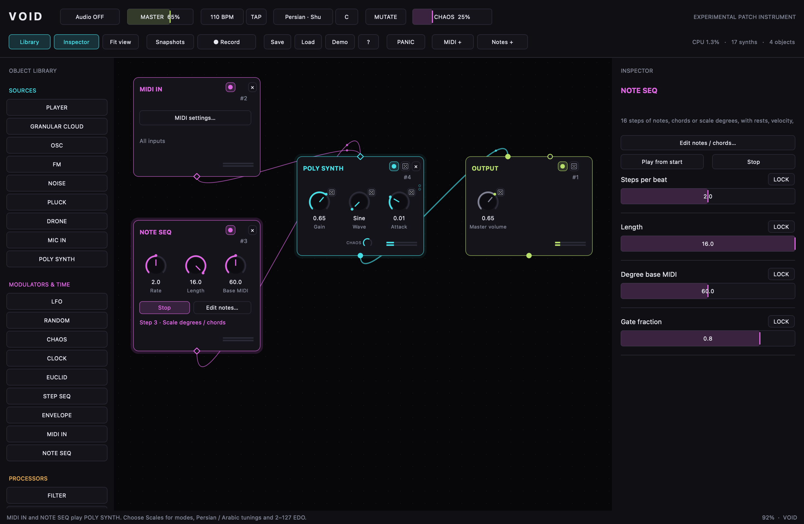

# VOID

Ali Balighi © 2026  
[alibalighi.com](https://alibalighi.com)

A node-based experimental music instrument in one SuperCollider file. All 38 objects, the GUI, routing, parameter automation, patch storage, and recording are implemented in **VOID.scd**. No installation, class files, Quarks, plugins, or library recompilation are needed.

## How to run

1. Open **VOID.scd** in the SuperCollider IDE (3.13 or newer, with Qt).
2. Select the entire file and press **Cmd+Enter** on macOS or **Ctrl+Enter** on Windows/Linux.
3. Wait for the server to boot and the VOID window to appear. **Demo** plays a ready-made patch immediately.

The app uses the audio device selected in SuperCollider. Closing the window releases its own audio resources and leaves a shared server running. After Cmd/Ctrl+Period, click **Restart audio**, then **Audio ON** to resume.

## Quick start: five steps to a first patch

1. Double-click empty canvas, type **OSC**, and press Enter.
2. Find the permanent lime **OUTPUT** object. Press **F** if you need to fit both objects onscreen.
3. Drag OSC's filled bottom outlet to OUTPUT's filled top inlet. You should hear the oscillator.
4. Drag Frequency or Gain vertically. Hold Shift for fine adjustment; double-click a knob to enter a value.
5. Turn on Frequency's little dice button. Select OSC and use the inspector to adjust its random mode, rate, depth, and window.

To start with sounds instead, drop a file on the canvas for PLAYER. Hold Shift while dropping for GRANULAR CLOUD. Drop more files on an existing cloud or use **Add sound…** to build its pool.

## Objects

| Category | Objects |
| --- | --- |
| Sources · cyan | PLAYER, GRANULAR CLOUD, OSC, FM, NOISE, PLUCK, DRONE, MIC IN, POLY SYNTH |
| Modulators & time · magenta | LFO, RANDOM, CHAOS, CLOCK, EUCLID, STEP SEQ, ENVELOPE, MIDI IN, NOTE SEQ |
| Processors · amber | FILTER, DELAY, REVERB, SPECTRAL, PITCH SHIFT, CRUSH, DISTORT, RING / FREQ SHIFT, STUTTER, RESONATOR, COMPRESSOR |
| Utility · lime | MIXER, PAN, VCA / GAIN, XFADE, SCOPE, OUTPUT, RECORDER, NOTE, MIDI OUT |

Filled round ports carry stereo audio. Hollow round ports carry control signals or triggers. Diamond ports carry note events, including polyphonic chords, velocity and pitch bend. Hover a port to see its name. Audio cables can fan out and sum into an inlet. Feedback connections are supported.

Drag a hollow control outlet onto a knob to modulate that parameter. Parameters beyond the three visible knobs also have small hollow targets down the node's right edge; hover to identify them. The inspector exposes every knob and its modulation depths. Click a cable to adjust its gain/depth, including negative values, or delete it.

PLAYER preserves stereo. Drag the two waveform edge markers to change start and end; use its Trigger inlet or **Trigger / restart** in the right-click menu to restart playback. Rate can be negative. Its Loop parameter chooses looping or one-shot playback.

GRANULAR CLOUD uses mono grain sources and has a pool of up to 16 sounds. Fractional Sound / morph values blend neighboring pool entries by choosing between them per grain. Its waveform follows the sound currently being chosen. Envelope shape selects Hann, percussive, flat-top, or reverse envelopes. Freeze holds the scan position.

OSC morphs Sine → Saw → Square → Triangle → Pulse. Its FM inlet accepts stereo audio and uses the mono sum. Unison supports 1–7 voices. The inspector can switch pitch entry between Hz and MIDI note numbers.

STEP SEQ: drag in the bars to draw values. Click the small gate squares below the bars to toggle gates. Alt-drag in the bars to draw per-step probabilities; the narrow bottom strips show them. **Output gates** changes the outlet from held values to triggers. Its mutate button nudges the pattern.

SCOPE switches between a waveform and a 32-band spectrum. ENVELOPE supplies both an envelope control outlet and a stereo VCA output. RECORDER's button records the protected master, as does the top-bar Record button. Double-click NOTE's body to edit it.

## Object help and playable examples

Select an object on the VOID canvas and press **Cmd+D** on macOS or **Ctrl+D** on Windows/Linux. The shortcut also works inside VOID's text and number editors. With no object selected, it opens Start here / Shortcuts. The **?** toolbar button, **H**, the inspector's Help button and each object's right-click menu also open help. **Cmd/Ctrl+Shift+D** now duplicates objects.

All **38 objects** have a description in plain words, connection details, their controls, **three simple examples** and a fourth **complete musical piece**. Search the object list, then choose an example from the menu. **Copy code** copies the whole runnable SuperCollider block; **Copy description** copies the explanation. Paste code into the SuperCollider IDE and evaluate the whole block after evaluating VOID.scd. **Build example** creates the same patch directly in VOID. Examples add their own objects and use the existing OUTPUT; Undo removes the last build. **Stop examples** stops help-built examples while leaving other patch nodes running. Turn Audio ON to listen. Escape closes help.

The fourth example, **Glass Garden**, is an arranged piece with four eight-bar sections: Dawn, Motion, Mirror and Return. It combines independent melody, chord and bass sequencers, Euclidean plucked percussion, a scanning granular texture, a mixer, filter, echoes, reverb and stereo movement. Harmony changes every two bars, and the sections change the melody, instruments, rhythm and dynamics. A two-bar tail ends the piece. It uses the current tempo, scale and root, including microtonal tunings; at 110 BPM it lasts about 74 seconds. Each object's fourth example includes that object in the piece and explains its role.

The full written guide is in **[HELP.md](HELP.md)**. **[Examples/Glass-Garden.scd](Examples/Glass-Garden.scd)** contains the complete copyable score and patch-building code. MIDI examples require a chosen device, MIC IN starts at gain zero, and recording starts when you press Record.

**[Fifty new studies](Examples/README.md)** provide a separate learning collection, with one independent `.scd` file per example. The sequence moves through phrasing, chords and voice leading, hockets and polymeter, sampling and effects, Persian and Arabic reference collections, 19–127 EDO studies, custom cents and non-octave tuning, then canons and arranged pieces. Every file explains its musical idea, gives three variations to try, and plays a finite score with a release tail. Open VOID first, then evaluate one study's complete block. These studies set the shared tempo, root and tuning; use Undo or delete the selected study group before moving on.

## MIDI input and output

Click **MIDI +** in the toolbar to create **MIDI IN → POLY SYNTH → OUTPUT**. Choose your input device and channel, click **Apply settings**, and play. Audio must be ON. The MIDI settings button also refreshes the device list after connecting a controller. MIDI is initialized automatically; no extra SuperCollider commands are required.

POLY SYNTH has 32 active voices, five waveforms (sine, saw, square, triangle and FM), velocity, attack/release, cutoff, sustain pedal CC64 and channel pitch bend. Changes to waveform, envelope and cutoff also reach held voices. Note-on with velocity zero and CC120/123 release notes. Removing a note cable, bypassing/deleting an object, stopping a sequence or pressing PANIC releases its notes. PANIC also stops all note sequencers. After Cmd/Ctrl+Period, use **Restart audio**, then **Audio ON**.

MIDI IN offers three keyboard mappings:

- **Chromatic MIDI:** pass incoming note numbers unchanged.
- **Nearest pitch in global scale:** quantize each incoming note to the global tuning.
- **Scale degrees:** consecutive keys walk through successive tuning degrees; key 60 plays the tonic at MIDI 60 plus Root. In 127 EDO, key 61 is one 127-EDO step above key 60. Octaves follow the selected tuning's degree count.

To send MIDI to another instrument or DAW, add **MIDI OUT** and connect MIDI IN or NOTE SEQ's diamond outlet to its diamond inlet. Choose the destination in **MIDI settings…**. On macOS, enable an IAC bus in Audio MIDI Setup when you need a virtual connection to another application; choose that bus as VOID's destination and as the DAW's input.

**MPE / channel per note** preserves independent microtonal chord pitches using channels 2–16, with up to 15 voices. VOID sends pitch-bend sensitivity using RPN 0; the receiver must accept that range and independent channel bends. The output defaults to ±48 semitones. **Standard** mode uses the selected single channel and rounds fractional MIDI pitches to semitones. Internal POLY SYNTH preserves fractional pitches directly. A note cable's **Velocity scale** adjusts its note-on velocities.

## Note and chord sequencer

Click **Notes +** to create **NOTE SEQ → POLY SYNTH → OUTPUT**, open its editor, and choose **Apply & play**. This is separate from STEP SEQ, which remains a control/trigger sequencer.

Each of the 16 steps has an enable switch, notes, velocity, probability and duration. Enter one note, several space/comma-separated notes for a chord, or `rest`, `-`, or an empty field for a rest. Use the inspector for the number of active steps, steps per beat, degree base pitch and gate fraction. Playback starts at the next beat on a shared tempo clock; BPM/TAP changes reach every note sequencer. Stop releases its sounding notes. Transport starts stopped after loading a patch.

- **Scale degrees:** `0 2 4` builds a triad from the global scale and mode. Negative degrees descend; fractional degrees interpolate adjacent degrees. Base MIDI sets the register, with 60 as middle C before Root is added.
- **MIDI pitches / note names:** `C4 E4 G4`, `60 64 67`, and `60 64.5 67` play literal pitches. C4 = MIDI 60. Decimal pitches support microtones. These literal pitches retain their tuning when the global scale changes.
- **Insert chord:** choose a step and root, then a scale triad/seventh/ninth in Degree mode, or major, minor, diminished, augmented, suspended, seventh, ninth, fourth/fifth stacks in MIDI mode. Apply saves the edit. Up to 16 notes can be entered per step.

Duration is a multiplier of one step: at two steps per beat, duration 1 lasts half a beat and duration 2 lasts a full beat. Gate fraction controls how much of that duration the notes are held. NOTE SEQ's parameters use manual values and locks; audio/control modulation targets and parameter dice apply to server-based objects.

## Scales, modes and microtonal tuning

Click the scale name or Root in the toolbar to open the searchable tuning browser. The catalog contains every scale and tuning supplied by the installed SuperCollider core library, Persian reference collections, and **every integer EDO from 2 through 127**. This includes the seven diatonic modes, harmonic/melodic major and minor, pentatonics, whole tone, diminished, ragas, Arabic maqamat, just intonation, Partch and other tunings. **Mode 0** retains the original collection; higher mode numbers rotate it. For example, Major mode 1 is Dorian. Root accepts fractional semitones.

The Persian references include Shur (natural/lowered fifth), Abu Ata, Dashti, Bayat-e Tork, Afshari, Segah, Chahargah, Homayun, Bayat-e Esfahan, Mahur, Nava and Rast Panjgah. These are labeled **24-EDO approximations**. Arabic presets use the core library's 24-tone reference tables, including Rast, Bayati, Hijaz, Saba, Sikah, Kurd, Nahawand and others. Dastgah and maqam practice varies in intonation, melodic direction and context; a fixed pitch collection is a starting point. The editable cents controls let you retain a specific tuning. See [LilyPond's Persian tuning notes](https://lilypond.org/doc/v2.26/Documentation/notation/persian-classical-music.html) for related modal relationships and tuning variation, and [SuperCollider's Scale documentation](https://doc.sccode.org/Classes/Scale.html) for its supplied collections.

**Copy selected scale to custom** fills the custom editor. Enter offsets in cents from the tonic, including 0 and excluding the period endpoint; choose a period, custom mode and root, then **Apply custom cents**. **Import Scala .scl…** accepts up to 512 ascending intervals in cents or ratios, with the last interval defining the period. Imported/custom tuning values are embedded in the patch, so the original `.scl` is not needed when reopening it. Non-octave periodic tunings are supported. The harmonic-series tuning is folded into pitch classes within its period.

Notes use the complete pitch collection. The server quantizers use a lookup containing actual tuned offsets instead of the previous 12-degree limit. Their nearest-pitch decision grid has 16,384 subdivisions per period (about 0.073 cents per subdivision for an octave); the stored target pitches retain their tuning. Scale choices feed note-degree sequencing, MIDI scale mapping, granular quantization and the existing parameter Scale dice mode.

## Dice, CHAOS, locks, and scale

- **Dice** moves a parameter around its base value. Depth sets its travel; Min and Max bound its window. The translucent knob arc shows the window and a moving dot shows the live parameter value.
- **Smooth / Step / Walk / Trigger / Scale** select smooth LFNoise2, stepped LFNoise0, a Brownian walk, clock/trigger-selected values, or scale-quantized pitch motion. Rate is in Hz. Trigger mode listens to global tempo and the object's Trigger inlet.
- **CHAOS** uses each object's own musical behavior: player jumps and reverse/stutters, granular scatter and bursts, oscillator octave motion and wave changes, filter sweeps and resonance spikes, delay glitches/freezes, spectral captures, and sequencer mutation. The header dice toggles it; the small CHAOS dial and inspector set its amount. The top bar sets a global amount.
- **LOCK** protects a parameter from dice, applicable object CHAOS, global mutation, and snapshot morphing. Manual editing remains available. OUTPUT volume starts locked.
- **MUTATE** nudges unlocked parameters. Right-click an object for a full randomization, a smaller nudge, trigger, bypass, duplicate, or delete.
- The global **Scale** and **Root** feed pitch quantizers. Scale mode applies to Hz, MIDI-root, and pitch-ratio parameters. Granular pitch scatter has its own quantize toggle.

## Snapshots, patches, and recording

**Snapshots** opens eight slots. Click an empty slot to store; Shift-click any slot to overwrite; click a filled slot to recall. A and B cycle the morph endpoints. Drag MORPH to interpolate normalized parameter values, rates, depths, and object CHAOS amounts. Locked parameters stay fixed during morphing. Snapshots also retain dice settings, locks, CHAOS switches, and step patterns, including NOTE SEQ notes and chords.

Save/Load store the full patch using SuperCollider archives: objects, positions, cable gains and modulation depths, parameter settings, sounds' absolute paths, note text, step patterns, note/chord patterns, MIDI device/channel/mapping settings, snapshots, tempo, scale/root/mode, embedded custom tunings, and view position. Playing notes and transport state are not restored. Original version-1 patches retain their six original scale indices. Sounds are referenced rather than embedded. Missing sounds appear as missing entries and remain silent; the remaining patch stays usable. Remove or replace them from the inspector. Undo/redo retain 60 patch states.

Record writes a timestamped, stereo floating-point WAV to **Platform.recordingsDir**. The timer appears in the toolbar and RECORDER nodes. Press Record again to finalize its header. The saved path appears in the status line and post window. Audio OFF mutes the hardware output; master recording still receives the master signal.

## Keyboard shortcuts

| Shortcut | Action |
| --- | --- |
| Double-click empty canvas | Search/add an object |
| Search: Up / Down / Enter / Esc | Choose / add / close |
| Drag empty canvas | Rubber-band selection |
| Shift-click an object | Add/remove selection |
| Space-drag or middle-drag | Pan |
| Canvas edge sliders | Pan horizontally and vertically |
| Wheel | Pan; scroll library/inspector when over a panel |
| Cmd/Ctrl + wheel | Zoom around the pointer |
| F | Fit view |
| Drag knob / Shift-drag | Adjust / fine adjust |
| Double-click knob | Type a value |
| Alt/Option-click knob | Reset to default |
| Cmd/Ctrl + A | Select all |
| Cmd/Ctrl + D | Object help, descriptions and examples |
| Cmd/Ctrl + Shift + D | Duplicate selection |
| Cmd/Ctrl + C / V | Copy / paste objects and internal cables |
| Delete or Backspace | Delete selected objects/cable; OUTPUT stays |
| B | Bypass selection |
| Cmd/Ctrl + Z | Undo |
| Cmd/Ctrl + Shift + Z, or Ctrl + Y | Redo |
| Cmd/Ctrl + S / O | Save / load patch |
| M | Mutate |
| T | Tap tempo |
| R | Start/stop master recording |
| P | Panic: instant silence |
| L / I | Toggle library / inspector |
| H or ? | Object help and examples |
| Esc | Close object help; cancel a cable drag; dismiss snapshots |
| Cmd/Ctrl + Period | Stop audio; use Restart audio to rebuild |

## Validation

The MIDI/tuning and object-help updates were runtime-tested on macOS with **SuperCollider 3.14.1**, Qt, bundled core classes and a separate scsynth server. It covers incoming MIDI chords, velocity-zero note-offs, sustain, pitch bend, channel filtering, audible bus routing, real CoreMIDI output loopback, independent microtonal MPE channels, sequencer transport and releases, GUI edits, Scala parsing, save/load and copy/paste, legacy patches, server quantization through 127 EDO, all 38 object types, voice cleanup, CmdPeriod/restart and shutdown. The help checks built all 114 simple examples, compiled all 156 copyable blocks, exercised keyboard and clipboard actions, and played the complete musical score. See **VALIDATION.md** for the recorded results and reproduction steps.

Run `tests/run-help-validation.sh` for help/examples and `tests/run-validation.sh` for MIDI/tuning on macOS with SuperCollider and Xcode command-line tools. It creates temporary native MIDI endpoints and uses separate language/server ports 57142/57143. Audio hardware output is muted during validation. Windows/Linux and SuperCollider 3.13 were not runtime-tested.

## Assumptions

- Your SuperCollider installation includes Qt and has a working stereo output device.
- Granular pools hold at most 16 sounds; grain envelopes are capped at one second.
- Patches reference absolute sound-file paths; they do not copy or embed audio files.
- Snapshot morphing uses normalized knob space, so exponential parameters move musically.
- Demo uses SuperCollider's bundled `a11wlk01.wav` when available and also has oscillator/drone sources.
